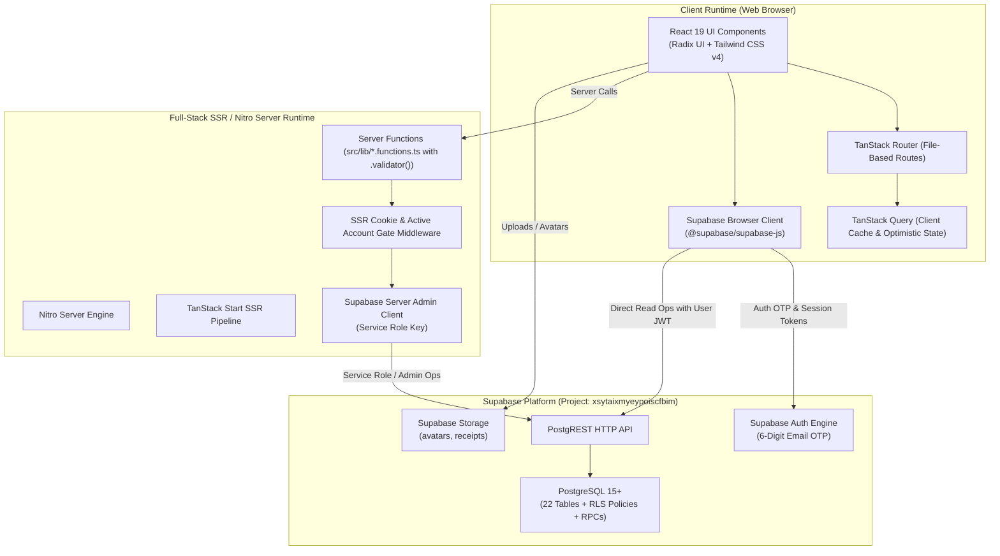

# Architecture Document — BillBuddy (Money Mind Frame)

**Document Version:** 1.2.0  
**Status:** Living Document / Authoritative  
**Target Runtime:** TanStack Start (SSR) + React 19 + Nitro + Supabase  
**Authoritative Supabase Project:** `xsytaixmyeypoiscfbim` (`https://xsytaixmyeypoiscfbim.supabase.co`)  
**Audit Verification:** 186/186 Tests Passing | TypeScript Strict: 0 Errors | Production Build: Clean (Zero Deprecation Warnings)  
**Last Updated:** 2026-10-23  

---

## 1. High-Level Architecture & System Context

BillBuddy is built as an isomorphic full-stack web application leveraging **TanStack Start** on top of **React 19** and the **Nitro** server engine. It utilizes **Supabase** as its managed backend platform for authentication, relational persistence (PostgreSQL), and object storage.

---

## 2. Server Functions Inventory (`src/lib/*.functions.ts`)

Server-side mutations and aggregations are strictly partitioned into 12 dedicated server function modules, fully modernized to `.validator()` schemas:

| Server Function Module | File Path | Scope & Responsibilities |
| :--- | :--- | :--- |
| **`account`** | [`src/lib/account.functions.ts`](file:///c:/Users/EESUB/Downloads/Bill%20Buddy/src/lib/account.functions.ts) | Profile updates, user settings, avatar upload URLs, GDPR data export, account closure. |
| **`admin`** | [`src/lib/admin.functions.ts`](file:///c:/Users/EESUB/Downloads/Bill%20Buddy/src/lib/admin.functions.ts) | Role-based permissions (`super_admin`, `finance_admin`, `support`), audit trails, system health. |
| **`bills`** | [`src/lib/bills.functions.ts`](file:///c:/Users/EESUB/Downloads/Bill%20Buddy/src/lib/bills.functions.ts) | Bill CRUD, recurrence occurrence generator, occurrence status transitions, bill archiving. |
| **`budgets`** | [`src/lib/budgets.functions.ts`](file:///c:/Users/EESUB/Downloads/Bill%20Buddy/src/lib/budgets.functions.ts) | Category budget limits, period tracking, overrun warning thresholds. |
| **`categories`**| [`src/lib/categories.functions.ts`](file:///c:/Users/EESUB/Downloads/Bill%20Buddy/src/lib/categories.functions.ts) | Default & custom expense categories, color and icon associations. |
| **`finance`** | [`src/lib/finance.functions.ts`](file:///c:/Users/EESUB/Downloads/Bill%20Buddy/src/lib/finance.functions.ts) | Cash-flow run rates, safe-to-spend projections, aggregated balances. |
| **`goals`** | [`src/lib/goals.functions.ts`](file:///c:/Users/EESUB/Downloads/Bill%20Buddy/src/lib/goals.functions.ts) | Spending goals CRUD, milestone progress, target dates. |
| **`insights`** | [`src/lib/insights.functions.ts`](file:///c:/Users/EESUB/Downloads/Bill%20Buddy/src/lib/insights.functions.ts) | Financial health calculations, spend distribution, anomaly detection. |
| **`jobs`** | [`src/lib/jobs.functions.ts`](file:///c:/Users/EESUB/Downloads/Bill%20Buddy/src/lib/jobs.functions.ts) | Idempotent background job claim keys, recurrence synchronization, reminder sweeps. |
| **`notifications`**| [`src/lib/notifications.functions.ts`](file:///c:/Users/EESUB/Downloads/Bill%20Buddy/src/lib/notifications.functions.ts) | In-app alerts, read state toggles, notification channel preferences. |
| **`payments`** | [`src/lib/payments.functions.ts`](file:///c:/Users/EESUB/Downloads/Bill%20Buddy/src/lib/payments.functions.ts) | Payment orders, state transitions (`CREATED` → `CAPTURED`), webhook persistence. |
| **`transactions`**| [`src/lib/transactions.functions.ts`](file:///c:/Users/EESUB/Downloads/Bill%20Buddy/src/lib/transactions.functions.ts) | Ledger writes, idempotency enforcement (`client_request_id`), append-only reversals. |

---

## 3. Database Schema: Complete Inventory (22 Tables)

All tables are defined idempotently in [`supabase/migrations/001_billbuddy_schema.sql`](file:///c:/Users/EESUB/Downloads/Bill%20Buddy/supabase/migrations/001_billbuddy_schema.sql) with enabled Row-Level Security:

1. **`public.profiles`**: Core user records, full name, email, avatar URL, onboarding state, `account_status`.
2. **`public.user_settings`**: Preferred currency, timezone, date format, UI theme.
3. **`public.notification_preferences`**: Channel preferences (in-app, email, push), reminder windows.
4. **`public.user_roles`**: Administrative RBAC mapping (`super_admin`, `finance_admin`, `support_admin`).
5. **`public.categories`**: Taxonomy for categorizing transactions and liabilities.
6. **`public.bills`**: Master liability records, recurrence schedule, amount, auto-pay flags.
7. **`public.bill_occurrences`**: Concrete scheduled instances of recurring bills.
8. **`public.bill_reminders`**: Scheduled reminder delivery timestamps and statuses.
9. **`public.payments`**: Historical settled payment logs.
10. **`public.transactions`**: Double-entry ledger with `client_request_id` idempotency and reversal references.
11. **`public.budgets`**: Category-specific spending limits and notification thresholds.
12. **`public.spending_goals`**: Milestone savings and spending targets.
13. **`public.notifications`**: In-app notifications with read status and deep links.
14. **`public.attachments`**: Metadata linking uploaded files to transactions/bills.
15. **`public.audit_logs`**: Tamper-evident log of administrative and security events.
16. **`public.support_tickets`**: User help desk and support requests.
17. **`public.support_ticket_messages`**: Messages exchanged within support tickets.
18. **`public.payment_orders`**: Strict state-machine tracked payment orders.
19. **`public.payment_attempts`**: Individual gateway transaction attempts under a payment order.
20. **`public.payment_events`**: Immutable webhook payloads received from payment providers.
21. **`public.closed_accounts`**: Audit records of deactivated/deleted accounts.
22. **`public.job_runs`**: Lock keys and execution tracking for scheduled recurring jobs.

### Storage Buckets & Policies
- **`avatars`**: Profile photos (user ID path-prefixed write access, public read).
- **`receipts`**: Encrypted receipt and invoice document scans (authenticated user isolated).
