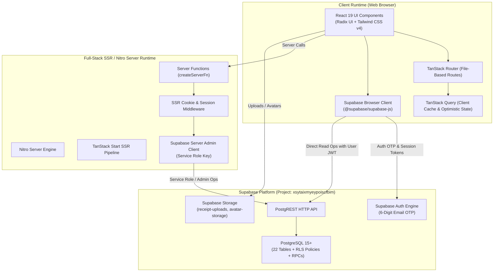
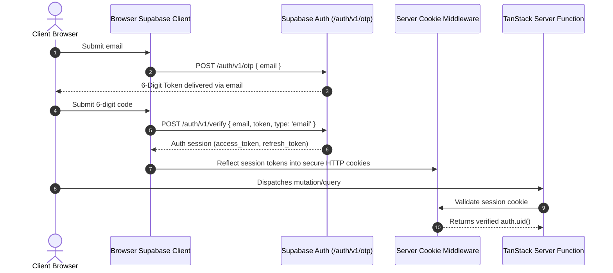
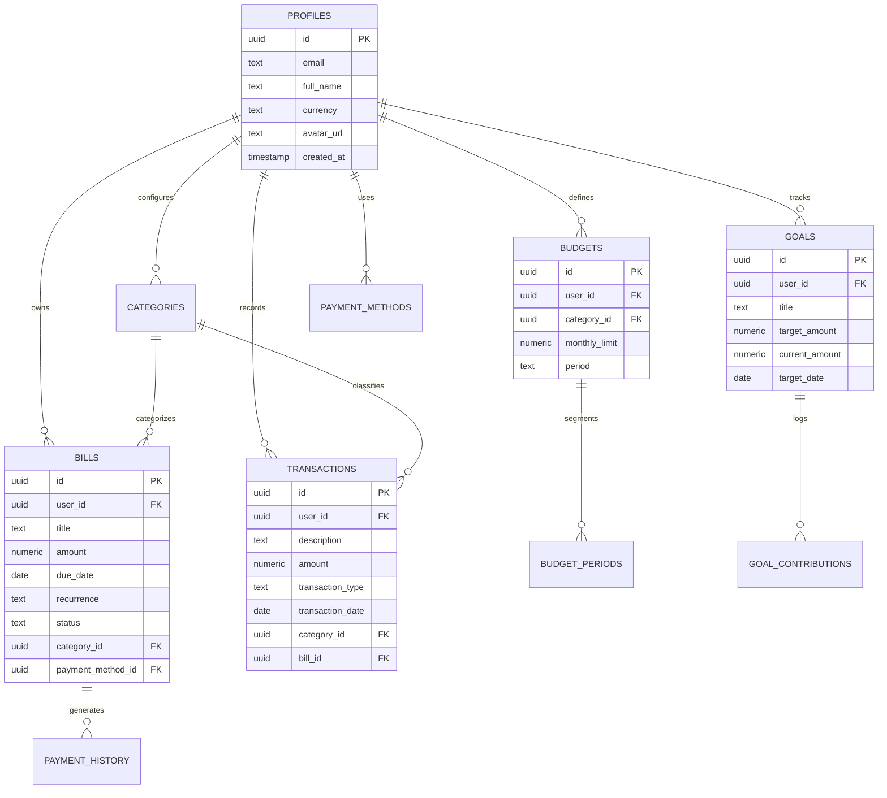

# Architecture Document — BillBuddy (Money Mind Frame)

**Document Version:** 1.0.0  
**Status:** Living Document / Authoritative  
**Target Runtime:** TanStack Start (SSR) + React 19 + Nitro + Supabase  
**Authoritative Supabase Project:** `xsytaixmyeypoiscfbim` (`https://xsytaixmyeypoiscfbim.supabase.co`)  
**Last Updated:** 2026-10-23  

---

## 1. High-Level Architecture & System Context

BillBuddy is built as an isomorphic full-stack web application leveraging **TanStack Start** on top of **React 19** and the **Nitro** server engine. It utilizes **Supabase** as its managed backend platform for authentication, relational persistence (PostgreSQL), and object storage.



---

## 2. Directory Structure & Codebase Organisation

The repository follows standard TanStack Start file-based routing and modular feature segregation:

```
c:\Users\EESUB\Downloads\Bill Buddy\
├── .gemini/                     # Development tooling & skills configurations
├── docs/                        # Legacy documentation & historical changelogs
├── public/                      # Static assets, icons, manifest
├── src/
│   ├── components/              # Reusable UI component library
│   │   ├── analytics/           # Charts, run-rate calculators, metric cards
│   │   ├── bills/               # Bill lists, creation modals, payment actions
│   │   ├── layout/              # App header, bottom nav, sidebar, theme toggles
│   │   ├── profile/             # Profile settings, preferences, export actions
│   │   ├── transactions/        # Transaction ledger, category selector, CSV import
│   │   └── ui/                  # Radix-based primitives (buttons, dialogs, inputs)
│   ├── contexts/                # React context providers (Theme, Auth, Finance)
│   ├── hooks/                   # Custom business hooks (useAuth, useFinance, useAccount)
│   ├── integrations/            # Third-party platform integrations
│   │   └── supabase/
│   │       ├── auth-middleware.ts # SSR cookie session management
│   │       ├── client.server.ts   # Server-side Supabase admin client
│   │       ├── client.ts          # Browser Supabase client (authoritative project)
│   │       └── types.ts           # Generated TypeScript database types
│   ├── lib/                     # Utilities, formatters, calculations, validation
│   ├── routes/                  # TanStack Router file-based route definitions
│   │   ├── __root.tsx           # Root route, shell, providers, DevTools
│   │   ├── index.tsx            # Landing & Home dashboard
│   │   ├── auth.tsx             # 6-digit email OTP authentication view
│   │   ├── bills.tsx            # Bill and recurring subscription management
│   │   ├── money.tsx            # Budgets, income, cash-flow ledger
│   │   ├── analytics.tsx        # Comprehensive financial health analytics
│   │   ├── settings.tsx         # User preferences, currency, notifications
│   │   └── profile.tsx          # Account details and data privacy controls
│   ├── app.css                  # Global Tailwind CSS v4 styling rules
│   ├── entry-client.tsx         # Browser hydration entry point
│   ├── entry-server.tsx         # SSR rendering entry point
│   └── router.tsx               # TanStack Router configuration & instance factory
├── supabase/
│   ├── migrations/              # Authoritative SQL migration files
│   │   └── 001_billbuddy_schema.sql # 22-table consolidated schema definition
│   └── config.toml              # Supabase CLI project configuration
├── package.json                 # Dependency manifests & script definitions
├── tsconfig.json                # TypeScript compiler configuration (strict mode)
└── vite.config.ts               # Vite 8 & TanStack Start build configuration
```

---

## 3. Technology Stack & Component Specifications

| Layer / Subsystem | Technology | Version | Purpose & Responsibilities |
| :--- | :--- | :--- | :--- |
| **Frontend Framework** | React | `^19.2.0` | UI rendering, concurrency, functional components |
| **Routing & SSR** | TanStack Start / Router | `^1.168.32` / `^1.170.18` | File-based routing, SSR streaming, server functions |
| **Build & Dev Server** | Vite | `^8.1.5` | Fast HMR, tree-shaking, production bundling |
| **Server Engine** | Nitro | `^3.0.260603-beta` | Lightweight server runtime for SSR & server functions |
| **Styling** | Tailwind CSS v4 | `^4.2.1` | Utility-first styling with modern CSS engine |
| **Component Primitives**| Radix UI | Various | Accessible, unstyled dialogs, dropdowns, tooltips |
| **Data Fetching / Cache**| TanStack Query | `^5.69.1` | Cache synchronization, deduplication, optimistic updates |
| **Data Visualisation** | Recharts | `^2.15.4` | Responsive SVG charts for financial metrics |
| **Backend & Database** | Supabase (PostgreSQL 15+)| `^2.111.0` | Relational data, Row-Level Security, Auth engine, Storage |
| **Runtime & Testing** | Bun / Vitest | `^4.1.10` | Fast local runtime and automated unit testing suite |

---

## 4. Architectural Boundaries & Data Flow

### 4.1 Client vs. Server Execution Boundary
- **Client Boundary (`src/routes`, `src/components`, `src/hooks`):**
  - Handles client-side view state, user event handling, and optimistic UI transitions.
  - Interacts with Supabase Auth for OTP submission and session maintenance.
  - Queries public views directly using the authenticated user JWT where appropriate.
- **Server Function Boundary (`createServerFn`):**
  - Isolates sensitive financial operations (e.g., balance updates, batch reconciliations, multi-table payment cascades).
  - Uses [`src/integrations/supabase/client.server.ts`](file:///c:/Users/EESUB/Downloads/Bill%20Buddy/src/integrations/supabase/client.server.ts) with the secure `SUPABASE_SERVICE_ROLE_KEY` to perform administrative operations while validating authorization via SSR cookies.

### 4.2 Authentication & Session Flow


---

## 5. Database Schema & Data Models

The BillBuddy persistence architecture consists of **22 normalized relational tables** in PostgreSQL, fully secured by Row-Level Security (RLS) where every row belongs to an authenticated user (`auth.uid() = user_id`).

### 5.1 Core Relational Entity Map


### 5.2 Complete Table Inventory (22 Tables)
1. **`public.profiles`**: Core user accounts, display preferences, locale settings, currency defaults.
2. **`public.bills`**: Master liability records, recurrence intervals, amount, due date, auto-pay flags.
3. **`public.payment_history`**: Immutable ledger of confirmed bill payments and settlement dates.
4. **`public.categories`**: System and user-defined categorization taxonomy for transactions and bills.
5. **`public.transactions`**: General ledger entries for income, expenses, and account transfers.
6. **`public.budgets`**: Category-specific spending limits and notification thresholds.
7. **`public.budget_periods`**: Historical monthly budget windows capturing target vs. actual variance.
8. **`public.goals`**: Target savings and debt elimination milestones.
9. **`public.goal_contributions`**: Individual funding allocations linked to specific goals.
10. **`public.payment_methods`**: Payment sources (credit cards, bank accounts, digital wallets).
11. **`public.notifications`**: Scheduled and triggered user alerts for overdue or upcoming liabilities.
12. **`public.notification_preferences`**: Granular channels (email, in-app) and lead times for alerts.
13. **`public.subscriptions`**: Metadata extensions for recurring SaaS and digital memberships.
14. **`public.income_sources`**: Anticipated recurring income streams for cash-flow projection.
15. **`public.debt_accounts`**: Dedicated debt balances, interest rates, and payoff targets.
16. **`public.financial_health_logs`**: Periodic snapshots of computed financial health scores.
17. **`public.recurring_rules`**: Advanced recurring schedules (e.g., 2nd Tuesday of each month).
18. **`public.attachments`**: Receipt images and invoice document references.
19. **`public.tags`**: Multi-dimensional tagging for transactions and liabilities.
20. **`public.transaction_tags`**: Many-to-many junction table between transactions and tags.
21. **`public.audit_logs`**: Security, login, and data export activity logging.
22. **`public.user_settings`**: Interface theme, feature flags, and dashboard layout preferences.

### 5.3 Storage Buckets & Policies
- **`receipt-uploads`**: Stores receipt and invoice scans linked to `attachments`. Restricted by user ID path prefix.
- **`avatar-storage`**: Publicly readable, authenticated user write-access for profile avatars.

---

## 6. External Integrations & Authoritative Endpoints

### 6.1 Supabase Authoritative Configuration
All client and server modules connect strictly to the authoritative Supabase project:
- **Project ID:** `xsytaixmyeypoiscfbim`
- **Base URL:** `https://xsytaixmyeypoiscfbim.supabase.co`
- **Browser Publishable Key:** `VITE_SUPABASE_PUBLISHABLE_KEY` (or `VITE_SUPABASE_ANON_KEY`)
- **Server Service Role Key:** `SUPABASE_SERVICE_ROLE_KEY` (kept strictly in server environment)

*Note: All historical references to deprecated or ghost projects (e.g. `ocajeaytrcakzoxavvvg` / `ocajeyatrckazoxavvgg`) have been completely purged from the codebase.*

---

## 7. Security Architecture & Threat Model

1. **Authentication Integrity:**
   - 6-digit numeric OTPs expire after 600 seconds.
   - Rate limiting enforced at the Supabase Auth gateway.
2. **Data Isolation (RLS):**
   - Every table enforces Row-Level Security.
   - Direct PostgREST queries evaluate `WHERE user_id = auth.uid()`.
3. **Server Secret Boundary:**
   - Vite bundling configuration strictly prohibits exporting `SUPABASE_SERVICE_ROLE_KEY` to browser bundles.
4. **Content Security & Sanitization:**
   - All user inputs are validated via Zod schemas prior to database persistence.
   - File uploads in `receipt-uploads` are restricted to MIME types: `image/jpeg`, `image/png`, `application/pdf`.

---

## 8. Build, Deployment & Environment Configuration

### Required Environment Variables

| Variable Name | Environment | Sensitivity | Description |
| :--- | :--- | :--- | :--- |
| `VITE_SUPABASE_URL` | Client & Server | Public | Supabase project URL (`https://xsytaixmyeypoiscfbim.supabase.co`) |
| `VITE_SUPABASE_PUBLISHABLE_KEY` | Client & Server | Public | Supabase Anon / Publishable key |
| `SUPABASE_SERVICE_ROLE_KEY` | Server Only | Secret | Administrative key for server functions & migrations |
| `NODE_ENV` | Server | System | Environment mode (`production`, `development`, `test`) |

### Deployment Pipeline
- Code pushes to `main` branch trigger continuous deployment on the connected Lovable / Vercel cloud infrastructure.
- Vite compiles client bundles while Nitro prepares the SSR runtime output.
