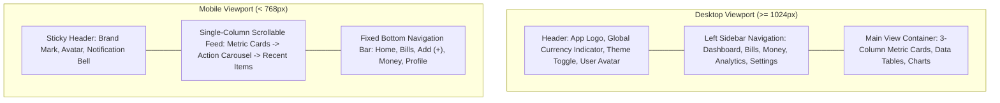

# Design System & UI/UX Guidelines — BillBuddy (Money Mind Frame)

**Document Version:** 1.1.0  
**Status:** Living Document / Authoritative  
**Styling Framework:** Tailwind CSS v4 (`@tailwindcss/vite`) + Radix UI Primitives  
**Iconography:** Lucide React  
**Charts & Visualisations:** Recharts  
**Verification:** Responsive Mobile & Desktop Layouts Verified  
**Last Updated:** 2026-10-23

---

## 1. Design Philosophy & Aesthetic Principles

BillBuddy's visual identity balances **financial clarity, trustworthiness, and effortless speed**. Because personal financial management frequently induces cognitive strain, the UI prioritizes calm, high-contrast visual hierarchies, reduced visual noise, and instantaneous feedback.

### Core Principles

- **Cognitive Calm & High Legibility:** Financial figures, dates, and balance changes must be legible at a glance with strict tabular numbers (`tabular-nums`) to avoid visual jitter during real-time updates.
- **Predictive Color Semantics:** Color is used purposefully. Green indicates liquidity, income, or verified paid status; Amber signals impending due dates; Rose/Red signifies liabilities, overdue status, or budget overruns. Neutral slates provide structure.
- **Progressive Disclosure:** Dense ledger rows and multi-tier analytics expand upon interaction rather than overwhelming the initial view.
- **Touch-Friendly & Adaptive:** Designed for high-velocity thumb interactions on mobile viewports while utilizing expansive dashboard real estate on desktop monitors.

---

## 2. Design Tokens & Color Palette

The interface is built on modern CSS custom properties structured for seamless light and dark mode toggling via Tailwind CSS v4.

### 2.1 Neutral Base Tokens

| Token                | Light Mode (Hex / HSL)         | Dark Mode (Hex / HSL)          | Application                  |
| :------------------- | :----------------------------- | :----------------------------- | :--------------------------- |
| `--background`       | `hsl(0, 0%, 100%)` (#FFFFFF)   | `hsl(222, 47%, 11%)` (#0F172A) | Main canvas background       |
| `--foreground`       | `hsl(222, 47%, 11%)` (#0F172A) | `hsl(210, 40%, 98%)` (#F8FAFC) | Primary text and headings    |
| `--card`             | `hsl(0, 0%, 100%)` (#FFFFFF)   | `hsl(217, 33%, 17%)` (#1E293B) | Elevated cards & widgets     |
| `--card-foreground`  | `hsl(222, 47%, 11%)` (#0F172A) | `hsl(210, 40%, 98%)` (#F8FAFC) | Text inside elevated cards   |
| `--muted`            | `hsl(210, 40%, 96%)` (#F1F5F9) | `hsl(217, 33%, 24%)` (#334155) | Secondary pills, row stripes |
| `--muted-foreground` | `hsl(215, 16%, 47%)` (#64748B) | `hsl(215, 20%, 65%)` (#94A3B8) | Captions, labels, timestamps |
| `--border`           | `hsl(214, 32%, 91%)` (#E2E8F0) | `hsl(217, 33%, 26%)` (#334155) | Card borders, dividers       |

### 2.2 Semantic & Financial Status Tokens

| Token             | Semantic Role       | Tailwind Utility Class               | Example Financial State                                 |
| :---------------- | :------------------ | :----------------------------------- | :------------------------------------------------------ |
| **Primary**       | Brand Blue / Indigo | `bg-primary`, `text-primary`         | Primary action buttons, active navigation tabs          |
| **Success**       | Emerald / Green     | `bg-emerald-500`, `text-emerald-600` | Confirmed paid bill, positive income, healthy budget    |
| **Warning**       | Amber / Orange      | `bg-amber-500`, `text-amber-600`     | Bill due within 72 hours, 80%+ budget threshold reached |
| **Destructive**   | Crimson / Rose      | `bg-rose-500`, `text-rose-600`       | Overdue bill liability, budget exceeded, delete actions |
| **Info / Accent** | Sky / Violet        | `bg-sky-500`, `text-violet-500`      | Goal progress indicators, recurring subscription tags   |

---

## 3. Typography & Numerical Formatting

The typographic scale uses system font stacks for native performance, zero flash-of-unstyled-text (FOUT), and maximum cross-platform rendering precision.

### 3.1 Font Families

- **Primary Interface Font:** System UI stack (`system-ui, -apple-system, BlinkMacSystemFont, 'Segoe UI', Roboto, Helvetica, Arial, sans-serif`).
- **Monospace & Numerical Stack:** `ui-monospace, SFMono-Regular, Menlo, Monaco, Consolas, monospace`.

### 3.2 Strict Financial Formatting Rules

1. **Tabular Numerals:** All currency amounts, percentages, and counters must include `tabular-nums` class to prevent horizontal layout shift during increments.
2. **Standard Currency Mask:** Always prefix with the user's selected ISO currency symbol (e.g., `$1,240.50`, `₹1,240.50`, `€45.00`, `£120.00`).
3. **Signed Deltas:** Positive cash flows explicitly prefix `+` with green tint (`+$4,500.00`), while liabilities or expenses prefix `-` with rose tint (`-$150.00`).

---

## 4. Component Library & Patterns

### 4.1 Buttons & Interactive Controls

- **Primary Action Button:** High-contrast solid background (`bg-primary text-primary-foreground hover:opacity-90 active:scale-[0.98]`). Used exclusively for the main page task (e.g., "Add Bill", "Verify Code").
- **Secondary / Outline Button:** Subtle border with hover fill (`border border-border bg-card hover:bg-muted text-foreground`). Used for cancel actions, secondary filters, and exports.
- **Destructive Button:** Red fill or outline (`bg-rose-600 text-white hover:bg-rose-700`). Reserved for deleting bills, resetting categories, or deleting accounts.
- **Loading State:** Disabled button state with a spinning Lucide `Loader2` icon and preserved button width to prevent layout shifts.

### 4.2 Bill & Transaction Status Badges

Badges communicate immediate operational status:

- **Paid / Settled:** `bg-emerald-50 text-emerald-700 border-emerald-200 dark:bg-emerald-950/40 dark:text-emerald-400 dark:border-emerald-800`
- **Pending / Upcoming:** `bg-amber-50 text-amber-700 border-amber-200 dark:bg-amber-950/40 dark:text-amber-400 dark:border-amber-800`
- **Overdue:** `bg-rose-50 text-rose-700 border-rose-200 dark:bg-rose-950/40 dark:text-rose-400 dark:border-rose-800`
- **Subscription:** `bg-violet-50 text-violet-700 border-violet-200 dark:bg-violet-950/40 dark:text-violet-400 dark:border-violet-800`

### 4.3 Form Inputs & Validation States

- **Standard Input:** Text, number, and date fields render with `h-10 px-3 py-2 border rounded-lg border-border focus:ring-2 focus:ring-primary focus:outline-none`.
- **OTP 6-Digit Verification Input:** 6 individual centered character blocks with auto-focus forward jumping and backspace retraction.
- **Error Feedback:** Red input border with an associated `p.text-xs.text-rose-600` validation error message anchored immediately beneath the field.

---

## 5. Page Layouts & Responsive Navigation

### Accessibility (a11y) Standards

1. **WCAG 2.1 AA Compliance:** Minimum color contrast ratio of 4.5:1 for standard text and 3:1 for large graphical metrics across both light and dark themes.
2. **Keyboard Navigation:** Complete tab-order indexability for all modals, bill actions, dropdowns, and date pickers with visible focus rings (`ring-2 ring-primary ring-offset-2`).
3. **Screen Reader Semantic Roles:** Radix UI ARIA labels attached to all dynamic status alerts and notifications.
4. **Motion Sensitivity:** Respects user system preference `prefers-reduced-motion: reduce`, disabling smooth transitions and chart entry animations where requested.
