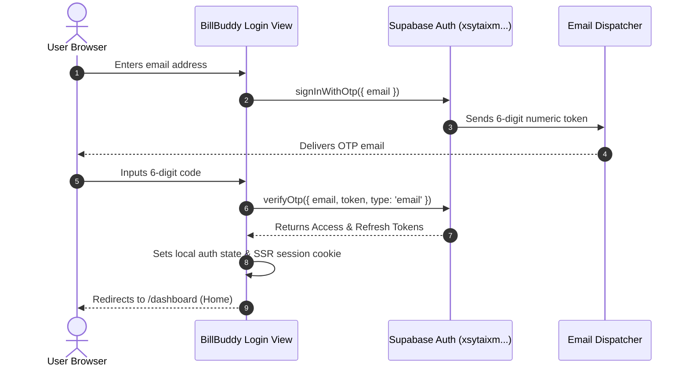
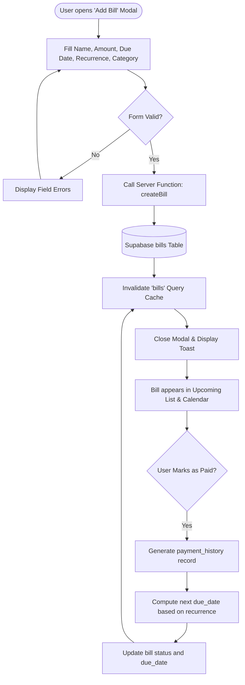

# Product Requirements Document (PRD) — BillBuddy (Money Mind Frame)

**Document Version:** 1.0.0  
**Status:** Living Document / Authoritative  
**Target Runtime:** TanStack Start (SSR) + React 19 + Supabase  
**Last Updated:** 2026-10-23  

---

## 1. Executive Summary & Vision

**BillBuddy** (also referenced as **Money Mind Frame**) is a full-stack personal financial intelligence and bill-management web application. The platform provides individuals, households, and freelancers with proactive visibility into recurring liabilities, cash-flow cycles, variable spending, savings targets, and debt amortisation.

### Core Value Proposition
- **Predictive Liability Tracking:** Transitioning from reactive bill payment to automated, calendarized run-rate forecasting.
- **Privacy-First Data Ownership:** Complete user data isolation using Supabase PostgreSQL Row-Level Security (RLS) policies.
- **Frictionless Authentication:** 6-digit email One-Time Password (OTP) verification eliminating password fatigue while ensuring secure device sessions.
- **Actionable Financial Analytics:** Real-time financial health scoring, subscription creep audits, and exportable audit trails (CSV/JSON/PDF) without mandatory third-party bank credential escrow.

---

## 2. Target Audience & User Personas

### 2.1 The Subscription-Heavy Professional ("Alex")
- **Profile:** 28–42 years old, maintains 15+ recurring SaaS, streaming, utility, and fitness memberships across multiple payment methods.
- **Core Pain Point:** Subscription creep, unexpected annual renewals, and difficulty tracking net cash outflow before payday.
- **Primary Need:** Proactive renewal alerts, cancellation recommendations, and upcoming bill run-rate projections.

### 2.2 The Budget-Conscious Household Planner ("Jordan")
- **Profile:** Manages shared family expenses, mortgage/rent payments, utilities, and emergency fund allocations.
- **Core Pain Point:** Misaligned cash flow where major bills coincide on the same week, causing temporary liquidity crunches.
- **Primary Need:** Calendarized cash-flow forecasting, categorized spending thresholds, and real-time budget vs. actual variance tracking.

### 2.3 The Debt & Savings Strategist ("Morgan")
- **Profile:** Working aggressively toward zero-debt milestones or targeted capital purchases (down payments, emergency reserves).
- **Core Pain Point:** Inability to see how paying an extra $100/month affects long-term debt payoff schedules or savings growth.
- **Primary Need:** Interactive goal tracking, debt payoff calculators, and net worth trend aggregation.

---

## 3. Product Scope & Functional Requirements

### 3.1 Authentication & Identity Management
- **REQ-AUTH-001 (Email OTP Delivery):** Users submit their email address to receive a secure, time-limited 6-digit OTP code (`supabase.auth.signInWithOtp`).
- **REQ-AUTH-002 (OTP Token Verification):** Users submit the 6-digit token alongside their email address (`supabase.auth.verifyOtp` with type `email`). Successful verification establishes a cryptographically signed session.
- **REQ-AUTH-003 (Session Persistence & SSR Cookie Mirroring):** Auth state is mirrored into secure HTTP cookies for TanStack Start SSR hydration and server function authorization.
- **REQ-AUTH-004 (Strict Email Isolation):** No magic links or legacy redirection URLs are permitted in production; authentication strictly completes within the active web application frame.
- **REQ-AUTH-005 (Graceful Sign Out):** Complete invalidation of client-side tokens and clearing of SSR session cookies on sign out.

### 3.2 Bill & Subscription Management
- **REQ-BILL-001 (CRUD Operations):** Create, read, update, archive, and delete recurring bills with custom recurrence frequencies (daily, weekly, bi-weekly, monthly, quarterly, semi-annually, annually).
- **REQ-BILL-002 (Status Lifecycle):** Mark bills across states: `pending`, `paid`, `overdue`, or `skipped`.
- **REQ-BILL-003 (Payment History):** Automatic generation of historical bill payment records upon confirmation of payment.
- **REQ-BILL-004 (Auto-Pay & Reminder Flags):** Configuration of lead-time alerts (e.g., 1 day, 3 days, 7 days prior) and auto-pay tracking flags.
- **REQ-BILL-005 (Category & Method Assignment):** Explicit linkage of bills to customizable expense categories and payment accounts (credit cards, checking accounts, cash).

### 3.3 Transaction Ledger & Expense Tracking
- **REQ-TXN-001 (Ledger Management):** Ingestion of income, expense, and transfer records with timestamp, merchant, category, amount, and notes.
- **REQ-TXN-002 (Bill-Transaction Reconcile):** Ability to link an outgoing expense transaction directly to an active bill liability.
- **REQ-TXN-003 (Batch Import / Export):** Ingestion of CSV bank statements with client-side header mapping and export of transaction logs to CSV and JSON.

### 3.4 Budgets & Financial Goal Setting
- **REQ-BDG-001 (Envelope & Category Budgets):** Allocation of spending ceilings per category on a calendar-month cadence.
- **REQ-BDG-002 (Run-Rate Variance Alerts):** Visual indicators when current spending velocity projects a budget overrun prior to month-end.
- **REQ-GOAL-001 (Savings Targets):** Creation of savings milestones with target amounts, target dates, and linked deposit allocations.
- **REQ-GOAL-002 (Visual Progress Metrics):** Percentage completion tracking and projected time-to-completion calculations based on historical contribution velocity.

### 3.5 Financial Intelligence & Reporting
- **REQ-REP-001 (Financial Health Score):** Algorithmic scoring evaluating debt-to-income ratio, savings rate, and on-time bill payment compliance.
- **REQ-REP-002 (Cash-Flow Projections):** Dynamic chart rendering projecting 30-day liquidity based on confirmed upcoming bills vs. anticipated recurring income.
- **REQ-REP-003 (Category Breakdown Visualizations):** Recharts-driven donut and bar visualizations itemizing expenditure distributions.

### 3.6 Profile & Account Configuration
- **REQ-PROF-001 (User Profile Management):** User customization of display name, primary currency (USD, EUR, GBP, CAD, AUD, etc.), date format, and avatar photo.
- **REQ-PROF-002 (Data Privacy & Export):** One-click full data export (JSON bundle of all user records) and self-service account erasure complying with GDPR/CCPA.

---

## 4. Non-Functional Requirements

### 4.1 Security & Compliance
- **NFR-SEC-001 (Row-Level Security):** 100% of database tables containing user-associated data must enforce PostgreSQL RLS policies where `auth.uid() = user_id`.
- **NFR-SEC-002 (Zero Secret Leakage):** Service-role keys and backend administrative credentials must never be bundled into client-accessible JavaScript artifacts.
- **NFR-SEC-003 (Input Sanitization):** All inputs processed through TanStack Start server functions must validate payloads using Zod schemas before database dispatch.

### 4.2 Performance & Responsiveness
- **NFR-PERF-001 (Hydration & TTI):** SSR initial page load under 1.2s on standard broadband; Time to Interactive (TTI) under 1.8s.
- **NFR-PERF-002 (Optimistic Updates):** Common interactions (marking a bill as paid, adding an expense) must apply TanStack Query optimistic cache updates immediately.
- **NFR-PERF-003 (Responsive Layouts):** Adaptive interfaces supporting mobile devices (320px+), tablets (768px+), and high-resolution desktop viewports (1440px+).

### 4.3 Data Integrity & Reliability
- **NFR-REL-001 (Foreign Key Cascade Integrity):** Deletion of a user profile automatically triggers clean cascade removal of bills, transactions, categories, and logs.
- **NFR-REL-002 (Idempotency):** Duplicate submissions of bill payment confirmations within a 5-second window must be de-duplicated at the server function layer.

---

## 5. User Workflows

### 5.1 Primary Authentication Journey

### 5.2 Bill Creation & Lifecycle Workflow

---

## 6. Constraints & Dependencies

### 6.1 Database Schema Dependencies
The application requires the complete 22-table PostgreSQL schema defined in `supabase/migrations/001_billbuddy_schema.sql` to be active on project `xsytaixmyeypoiscfbim`. Until applied, database calls will return schema cache misses.

### 6.2 External Platform Guardrails
- **Lovable Sync Guardrail:** Changes pushed to repository branch `main` sync directly to the Lovable deployment engine. Force-pushing, history re-writing, and unverified package upgrades are prohibited.
- **Third-Party Integrations:** Open banking/Plaid connections remain disabled in v1.0, relying on CSV import and manual logging to maintain zero vendor risk.

---

## 7. Assumptions & Open Inquiries

1. **Multi-Currency Conversion:** The v1.0 PRD assumes transactions and bills within a single profile use the profile's primary selected currency. Dynamic multi-currency exchange rate conversions are deferred to v2.0.
2. **Notification Delivery:** Push notifications currently run via in-app banner/toast notifications and browser local storage reminders; native SMS and WebPush push endpoints are flagged for future phase development.
