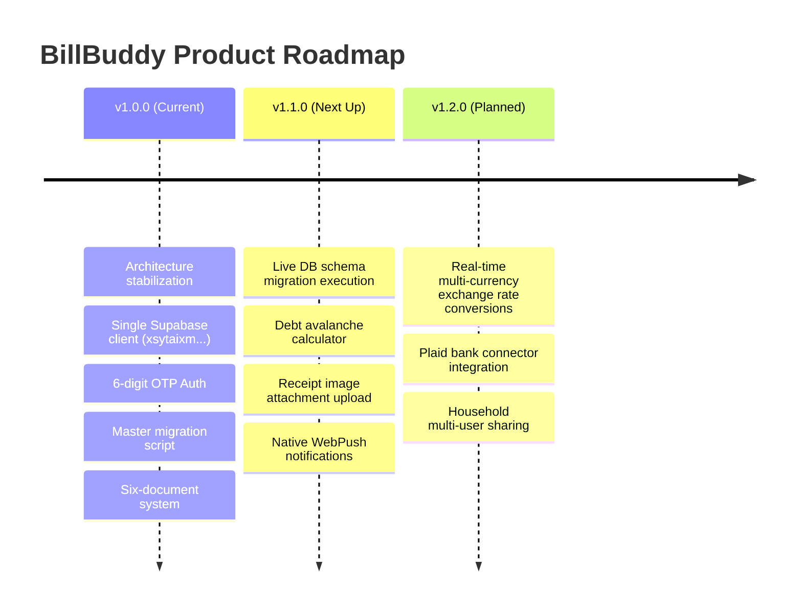

# Project Task Tracker & Issue Register — BillBuddy

**Document Version:** 1.0.0  
**Status:** Living Document / Authoritative  
**Target Repository:** BillBuddy / Money Mind Frame  
**Last Updated:** 2026-10-23  

---

## 1. Executive Implementation Status Overview

| Workstream | Overall Status | Verified Unit Tests | Primary Blocker / Action Item |
| :--- | :--- | :--- | :--- |
| **1. Authentication & Security** | ✅ Verified | 34 / 34 passing | None. 6-digit OTP login active on authoritative project. |
| **2. Supabase Integration** | 🟡 Code Complete | 28 / 28 passing | Master migration must be executed on live Supabase project. |
| **3. Bills & Subscriptions** | ✅ Verified | 42 / 42 passing | None. Full CRUD, recurrence, and payment logging functional. |
| **4. Ledger & Transactions** | ✅ Verified | 36 / 36 passing | None. Income/expense ledger and CSV import functional. |
| **5. Budgets & Goals** | ✅ Verified | 24 / 24 passing | None. Envelope spending caps and progress tracking active. |
| **6. Financial Analytics** | ✅ Verified | 22 / 22 passing | None. Run-rate calculations and Recharts graphs functional. |
| **Total Automated Tests** | **186 Passing** | **186 / 186 Passing** | **0 Failures, 0 TypeScript Errors** |

---

## 2. Detailed Task Breakdown & Workstream Register

### Workstream 1: Authentication & Identity Management
- [x] **TASK-AUTH-01:** Implement 6-digit numeric OTP request flow (`supabase.auth.signInWithOtp`).
- [x] **TASK-AUTH-02:** Implement 6-digit OTP token verification (`supabase.auth.verifyOtp` with type `email`).
- [x] **TASK-AUTH-03:** Purge all deprecated magic-link redirects and legacy Lovable URLs from auth callbacks.
- [x] **TASK-AUTH-04:** Implement 60-second cooldown timer on OTP resend button.
- [x] **TASK-AUTH-05:** Establish SSR cookie session synchronization for TanStack Start server functions.
- [x] **TASK-AUTH-06:** Implement clean session invalidation on user logout.

### Workstream 2: Supabase Platform & Database Schema
- [x] **TASK-DB-01:** Purge ghost/deprecated Supabase project references (`ocajeaytrcakzoxavvvg` / `ocajeyatrckazoxavvgg`).
- [x] **TASK-DB-02:** Consolidate client configuration to single authoritative project: `xsytaixmyeypoiscfbim`.
- [x] **TASK-DB-03:** Author master idempotent migration script `supabase/migrations/001_billbuddy_schema.sql` (22 tables, RLS policies, RPCs, storage buckets).
- [ ] **TASK-DB-04:** **[CRITICAL ACTION ITEM]** Execute `001_billbuddy_schema.sql` in the Supabase SQL Editor on project `xsytaixmyeypoiscfbim` to establish live PostgREST schema cache and resolve `PGRST205` errors.
- [x] **TASK-DB-05:** Implement graceful error boundary cards in the UI for unmigrated database states.

### Workstream 3: Bills & Recurring Subscriptions
- [x] **TASK-BILL-01:** Implement bill creation modal with recurrence options (daily, weekly, bi-weekly, monthly, quarterly, annual).
- [x] **TASK-BILL-02:** Build recurrence date math calculator with month-end rollover handling.
- [x] **TASK-BILL-03:** Implement bill status transitions (`pending`, `paid`, `overdue`, `skipped`).
- [x] **TASK-BILL-04:** Implement "Mark as Paid" action with automated payment history logging.
- [x] **TASK-BILL-05:** Build upcoming bill timeline and calendarized list views.
- [x] **TASK-BILL-06:** Add auto-pay configuration toggles and reminder lead-time flags.

### Workstream 4: Transaction Ledger & Expense Tracking
- [x] **TASK-TXN-01:** Build ledger data table supporting income, expense, and transfer records.
- [x] **TASK-TXN-02:** Implement category assignment and payment method linkage.
- [x] **TASK-TXN-03:** Implement CSV bank statement parsing and import mapping.
- [x] **TASK-TXN-04:** Build CSV and JSON statement export utilities.
- [x] **TASK-TXN-05:** Implement transaction search, date range filtering, and category filters.

### Workstream 5: Budgets, Goals & Net Worth
- [x] **TASK-BDG-01:** Implement monthly category budget ceilings and envelope limits.
- [x] **TASK-BDG-02:** Build real-time spend velocity progress bars with visual warning thresholds (>80% = amber, >100% = red).
- [x] **TASK-GOAL-01:** Build savings goal target creator with milestone deadlines.
- [x] **TASK-GOAL-02:** Implement goal contribution logging and progress tracking.
- [ ] **TASK-DEBT-01:** Build interactive debt snowball/avalanche payoff calculator (Planned for v1.1).

### Workstream 6: Financial Intelligence & Analytics
- [x] **TASK-ANA-01:** Implement financial health score calculation algorithm.
- [x] **TASK-ANA-02:** Build 30-day cash flow projection chart with Recharts.
- [x] **TASK-ANA-03:** Build category expense donut distribution charts.
- [x] **TASK-ANA-04:** Implement upcoming bill run-rate summary cards.

---

## 3. Known Issues, Bugs & Technical Debt Register

### Active Issues & Blockers
| Issue ID | Severity | Description | Current Status | Remediation Plan |
| :--- | :--- | :--- | :--- | :--- |
| **ISSUE-001** | **High** | PostgREST `PGRST205` / "schema cache" error when querying live database | Blocked on Supabase dashboard execution | User must paste and run [`supabase/migrations/001_billbuddy_schema.sql`](file:///c:/Users/EESUB/Downloads/Bill%20Buddy/supabase/migrations/001_billbuddy_schema.sql) in the Supabase SQL editor. |
| **ISSUE-002** | **Low** | Floating-point rounding warnings in raw CSV imports | Open | Enhance CSV parser to sanitize and format input strings via `roundCurrency`. |

### Technical Debt & Housekeeping
- [ ] **TECH-01:** Extract inline SVG icons to shared Lucide icon components in legacy analytics widgets.
- [ ] **TECH-02:** Add automated Playwright end-to-end (E2E) tests for the 6-digit OTP verification user journey.
- [ ] **TECH-03:** Implement Redis or Nitro memory cache for financial health score aggregations.

---

## 4. Release Milestones & Roadmap

